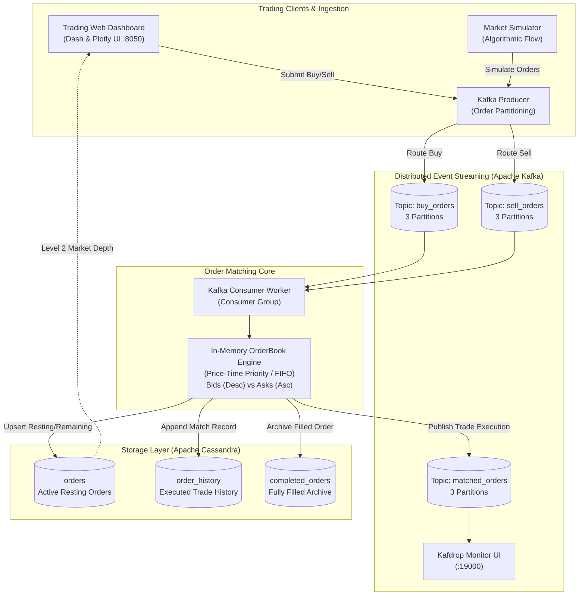

# 📈 Real-Time Stock Order Matching Engine & Trading Exchange Architecture

[](https://github.com/rodrigo85/python_kafka_stock_trade/actions)
[](https://www.python.org/)
[](https://kafka.apache.org/)
[](https://cassandra.apache.org/)
[](https://www.docker.com/)
[](https://dash.plotly.com/)
[](https://github.com/astral-sh/ruff)
[](LICENSE)

A production-grade, distributed **Real-Time Electronic Stock Trading & Order Matching Engine** engineered using **Python**, **Apache Kafka**, **Apache Cassandra**, and **Plotly Dash**.

The system simulates an institutional central limit order book (CLOB), enforcing strict **Price-Time Priority (FIFO)** execution algorithms, event-driven streaming, market depth visualization, and horizontally scalable NoSQL persistence.

---

## 📑 Table of Contents

- [Architecture Overview](#-architecture-overview)
- [Financial Exchange Mechanics & Principles](#-financial-exchange-mechanics--principles)
- [Repository Structure](#-repository-structure)
- [Step-by-Step Guide: How to Run and Test Locally](#-step-by-step-guide-how-to-run-and-test-locally)
  - [Daily Developer Cheat Sheet](#-daily-developer-cheat-sheet)
- [Synthetic Market Order Flow Simulator](#-synthetic-market-order-flow-simulator)
- [Automated Testing & CI/CD](#-automated-testing--cicd)
- [Cassandra NoSQL Data Modeling](#-cassandra-nosql-data-modeling)
- [Demo Video](#-demo-video)

---

## 🏛 Architecture Overview



### End-to-End Pipeline Workflow

1. **Order Creation:** Traders place orders via the Dash Web UI or automated algorithmic scripts via the Kafka producer.
2. **Event Streaming:** Limit orders are serialized into JSON and dispatched to partitioned Kafka topics (`buy_orders`, `sell_orders`).
3. **Order Matching:** The Kafka Consumer routes orders to the in-memory `OrderBook`. The matching algorithm matches buy orders against the lowest resting sell orders (and sell orders against highest resting buy orders).
4. **Trade Execution:** When prices cross or match, trades execute at the resting order's price. Matched events are broadcast to the `matched_orders` topic for downstream analytics.
5. **NoSQL Persistence:** Active resting quantities, completed orders, and historical trade logs are persisted to Apache Cassandra.
6. **Real-Time Visualization:** The Dash UI polls the resting market depth and live queue, rendering a horizontal Level 2 market depth chart.

---

## 💎 Financial Exchange Mechanics & Principles

### 1. Strict Price-Time Priority (FIFO)
* **Bids (Buy Orders):** Sorted with the highest price at the top of the book. When multiple orders have identical bid prices, the order that arrived earliest (smallest timestamp) receives execution priority.
* **Asks (Sell Orders):** Sorted with the lowest price at the top of the book. Ties are broken strictly by arrival timestamp.

### 2. Price Improvement Rule
When an incoming aggressive order enters the market with a price that crosses the spread (e.g. a buyer willing to pay up to $155 when the lowest seller asks $150), execution occurs at the **resting order's price** ($150). The buyer benefits from $5.00 of price improvement.

### 3. Partial Fills & Priority Retention
If a 100-share buy order matches against a resting 40-share sell order:
- A trade match of 40 shares executes.
- The sell order is marked fully filled and archived.
- The remaining 60 shares of the buy order remain at the head of the buy queue with their **original priority timestamp intact**, preserving fairness.

### 4. Decoupled Event-Driven Streaming
Publishing executed trades to the `matched_orders` topic enables asynchronous downstream integrations (clearing houses, audit logs, notification engines) without blocking the low-latency matching core.

---

## 📁 Repository Structure

```
.
├── .github/
│   └── workflows/
│       └── ci.yml                 # Automated CI: Linting, Type Checking, Unit Tests & Compose Validation
├── backend/
│   ├── __init__.py
│   ├── cassandra_db.py            # Resilient Cassandra client with prepared statements & retries
│   ├── order.py                   # Validated Order domain model with (de)serialization
│   └── order_book.py              # Core Price-Time Priority in-memory matching engine
├── frontend/
│   ├── __init__.py
│   ├── app.py                     # Plotly Dash web application entrypoint
│   ├── callbacks.py               # Reactive UI callbacks (depth chart, order forms, live queue)
│   └── layout.py                  # Responsive HTML/CSS layout components
├── kafka/
│   ├── __init__.py
│   ├── consumer.py                # High-throughput Kafka consumer event loop with graceful shutdown
│   └── producer.py                # Partitioned Kafka producer with delivery callbacks
├── scripts/
│   ├── init_cassandra.cql         # CQL schema initialization (keyspace, orders, history, archive)
│   └── market_simulator.py        # Realistic multi-ticker synthetic order flow generator
├── tests/
│   ├── __init__.py
│   ├── test_order.py              # Domain model validations and edge cases
│   ├── test_order_book.py         # Complete matching engine test suite (exact match, partials, FIFO)
│   └── test_producer.py           # Message schema tests
├── create_kafka_topics.sh         # Idempotent Kafka topic creation script
├── docker-compose.yml             # Orchestration for Kafka, Cassandra, Kafdrop, Engine, and Dashboard
├── Dockerfile                     # Optimized container image build for Engine and UI
├── Makefile                       # Cross-platform developer automation commands
├── run.ps1                        # Native Windows PowerShell developer task runner
├── pyproject.toml                 # Ruff, Pytest, and Mypy configurations
├── requirements.txt               # Production application dependencies
└── requirements-dev.txt           # Testing, simulation, and linting dependencies
```

---

## 🚀 Step-by-Step Guide: How to Run and Test Locally

Follow this complete step-by-step tutorial to run the trading system, execute automated tests, and simulate live market trading on your machine.

### Prerequisites
* [Docker](https://www.docker.com/) & Docker Compose installed and running.
* [Python 3.10+](https://www.python.org/) installed.
* `git` installed.

---

### Step 1: Install Python Dependencies

Clone the repository and install the development dependencies:

```bash
# Optional: create and activate virtual environment
python -m venv .venv
# On Windows:
.venv\Scripts\activate
# On Linux / macOS:
source .venv/bin/activate

# Install dependencies
python -m pip install -r requirements-dev.txt
```

---

### Step 2: Start Trading Infrastructure with Docker Compose

Spin up all services (Zookeeper, Kafka, Cassandra, Kafka-Init, Cassandra-Init, Kafdrop, Engine, Dashboard):

```bash
# Using native Docker Compose:
docker compose up -d

# Or using Windows PowerShell shortcut:
.\run.ps1 up

# Or using Linux/macOS Makefile shortcut:
make up
```

Verify that all containers are healthy and running:
```bash
docker compose ps
```

*Services running:*
- `stock_kafka` on `localhost:9092` and `localhost:29092`
- `stock_cassandra` on `localhost:9042`
- `stock_kafdrop` on `http://localhost:19000` (Kafka Web UI)
- `stock_trading_dashboard` on `http://localhost:8050` (Trading UI)
- `stock_order_engine` (Matching Engine Worker)

---

### Step 3: Run Automated Unit Tests

Run the complete test suite verifying order creation, price-time priority, partial fills, and depth sweeps:

```bash
# Run pytest with verbose output
python -m pytest tests -v

# Or using shortcuts:
.\run.ps1 test   # Windows
make test        # Linux/macOS
```

*Expected Test Output:*
```text
tests/test_order.py::TestOrderModel::test_valid_buy_order PASSED
tests/test_order.py::TestOrderModel::test_valid_sell_order PASSED
tests/test_order.py::TestOrderModel::test_invalid_order_type_raises_error PASSED
tests/test_order.py::TestOrderModel::test_zero_or_negative_price_raises_error PASSED
tests/test_order.py::TestOrderModel::test_negative_quantity_raises_error PASSED
tests/test_order.py::TestOrderModel::test_serialization_to_and_from_dict PASSED
tests/test_order_book.py::TestOrderBookMatchingEngine::test_no_match_when_spread_not_crossed PASSED
tests/test_order_book.py::TestOrderBookMatchingEngine::test_exact_match PASSED
tests/test_order_book.py::TestOrderBookMatchingEngine::test_partial_fill_buy_order_remaining PASSED
tests/test_order_book.py::TestOrderBookMatchingEngine::test_partial_fill_sell_order_remaining PASSED
tests/test_order_book.py::TestOrderBookMatchingEngine::test_price_improvement_executes_at_resting_price PASSED
tests/test_order_book.py::TestOrderBookMatchingEngine::test_price_time_priority_fifo PASSED
tests/test_order_book.py::TestOrderBookMatchingEngine::test_multiple_price_levels_depth_sweep PASSED
tests/test_order_book.py::TestOrderBookMatchingEngine::test_sum_quantity_by_price_and_order_rows PASSED
tests/test_producer.py::TestProducerHelpers::test_create_order_schema PASSED
============================== 15 passed in 1.46s ==============================
```

---

### Step 4: Access the Trading Web Dashboard

Open your browser and navigate to:
👉 **[http://localhost:8050](http://localhost:8050)**

You will see:
1. **Interactive Market Depth Chart:** Real-time horizontal bar chart showing aggregated bid (blue) vs ask (red) volumes.
2. **Order Book Table:** Tabular Level 2 order queue showing buy quantities, prices, and sell quantities.
3. **Order Placement Form:** Allows entering custom prices, selecting quantities, and submitting Limit Buy or Sell orders.

---

### Step 5: Monitor Kafka via Kafdrop UI

Open your browser to:
👉 **[http://localhost:19000](http://localhost:19000)**

Inspect live Kafka topics:
- `buy_orders`: Live stream of incoming bid orders.
- `sell_orders`: Live stream of incoming ask orders.
- `matched_orders`: Stream of executed trade events.

---

### Step 6: Stream Synthetic Orders with the Market Simulator

Simulate realistic high-frequency order flow across the market:

```bash
# Generate 15 AAPL orders at 2.0 orders/second
python scripts/market_simulator.py --symbol AAPL --count 15 --rate 2.0

# Or using shortcut:
.\run.ps1 simulate   # Windows
make simulate        # Linux/macOS

# Or run indefinitely in live streaming mode:
python scripts/market_simulator.py --continuous --rate 1.0
```

*Expected Simulator Output:*
```text
[MARKET SIMULATOR] Target: AAPL (Base: $185.00) | Rate: 2.0/s
[START] Streaming synthetic orders to Kafka...
[SENT] BUY   100 AAPL @ $183.45 (User: trader_alpha)
[SENT] SELL  200 AAPL @ $186.20 (User: hedge_fund_xyz)
[SENT] BUY   150 AAPL @ $184.10 (User: quant_fund)
[SENT] SELL  100 AAPL @ $183.45 (User: algo_bot_42)  <-- TRIGGER MATCH!
[DONE] Total orders generated: 15
```

---

### Step 7: Verify Trade Executions in Cassandra

Query Cassandra to verify active resting orders and executed trade history:

```bash
# View recent executed trades:
docker exec stock_cassandra cqlsh -e "SELECT match_id, stock_symbol, price, matched_quantity, match_timestamp FROM stock_orders.order_history LIMIT 5;"

# View remaining resting orders:
docker exec stock_cassandra cqlsh -e "SELECT stock_symbol, order_type, price, quantity, status FROM stock_orders.orders LIMIT 5;"
```

---

### Step 8: Stop Containers (Teardown)

When finished testing, shut down the containers cleanly:

```bash
# Stop all services
docker compose down

# Or using shortcuts:
.\run.ps1 down   # Windows
make down        # Linux/macOS
```

---

### 💡 Daily Developer Cheat Sheet

| Task / Objective | Raw Terminal Command | Makefile Shortcut | PowerShell Shortcut |
| :--- | :--- | :--- | :--- |
| **Start Infrastructure** | `docker compose up -d` | `make up` | `.\run.ps1 up` |
| **Check Container Status** | `docker compose ps` | `docker compose ps` | `docker compose ps` |
| **Run Unit Tests** | `python -m pytest tests -v` | `make test` | `.\run.ps1 test` |
| **Simulate Market Order Flow** | `python scripts/market_simulator.py --count 15` | `make simulate` | `.\run.ps1 simulate` |
| **View Live Container Logs** | `docker compose logs -f` | `make logs` | `.\run.ps1 logs` |
| **Code Formatting / Linting** | `python -m ruff check .` | `make lint` | `.\run.ps1 lint` |
| **Stop All Containers** | `docker compose down` | `make down` | `.\run.ps1 down` |

---

## 🏛 Cassandra NoSQL Data Modeling

Apache Cassandra tables are engineered specifically for high-throughput single-partition queries:

```sql
-- 1. Active Orders Table: Partitioned by (stock_symbol, order_type, status)
CREATE TABLE stock_orders.orders (
    stock_symbol TEXT,
    order_type TEXT,
    status TEXT,
    order_id UUID,
    user_id TEXT,
    price DOUBLE,
    original_quantity INT,
    quantity INT,
    timestamp TIMESTAMP,
    PRIMARY KEY ((stock_symbol, order_type, status), order_id)
);

-- 2. Executed Trades Table
CREATE TABLE stock_orders.order_history (
    match_id UUID PRIMARY KEY,
    buy_order_id UUID,
    sell_order_id UUID,
    stock_symbol TEXT,
    price DOUBLE,
    matched_quantity INT,
    match_timestamp TIMESTAMP
);

-- 3. Completed Orders Archive Table
CREATE TABLE stock_orders.completed_orders (
    order_id UUID PRIMARY KEY,
    stock_symbol TEXT,
    order_type TEXT,
    user_id TEXT,
    price DOUBLE,
    original_quantity INT,
    quantity INT,
    completed_timestamp TIMESTAMP
);
```

---

## 🎥 Demo Video

Watch a recorded walkthrough of the project in action:
🔗 **[YouTube: Real-Time Stock Order Matching Engine Demo](https://youtu.be/inrQesrC7e4?si=kgktBdoYRYxzMHZv)**

---

## 📄 License

This project is licensed under the MIT License - see the [LICENSE](LICENSE) file for details.
